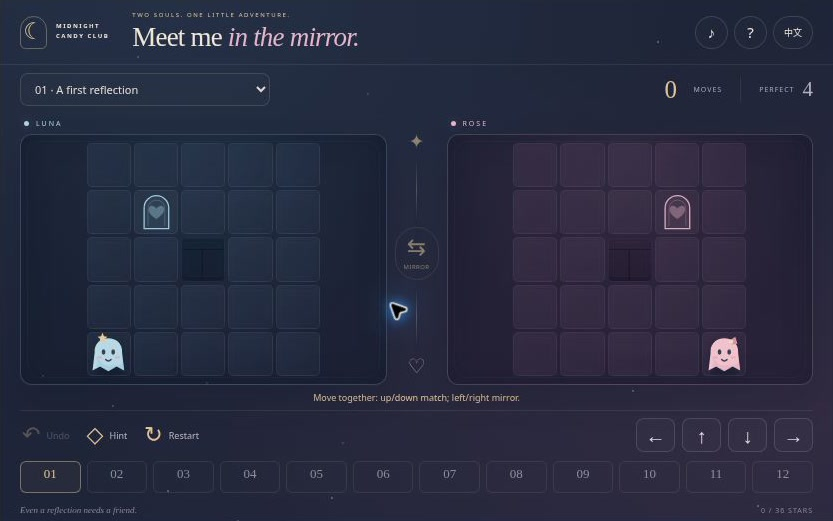
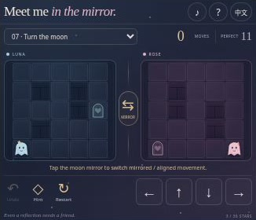

# Moonlit Mirrors — Halloween Mirror Puzzle Game

**Two little ghosts. One magical reflection. A dozen ways to find each other.** Moonlit Mirrors is a free Halloween puzzle game from Midnight Candy Club, created as a seasonal companion for [Love Game](https://love-game.org/). Move Luna and Rose at the same time through paired rooms, use walls to bring their paths into alignment, and guide both ghosts to their heart-shaped doorways.

**[Play online](https://halloween-mirror-hearts.crazy3d.org/)** · [Embedding guide](EMBEDDING.md) · [Game design](DESIGN.md)

**Live deployment:** Play on Cloudflare using the link above. The site is deployed from this GitHub repository. Hosting scripts and request logging may be added by Cloudflare independently of the game code.

[Video player and transcript](https://halloween-mirror-hearts.crazy3d.org/intro.html) · [Captioned MP4 file](docs/media/intro.mp4). The 24-second silent introduction uses actual game screenshots; it is not a live gameplay recording.



If these little ghosts make you smile, **[star the repository](https://github.com/AshinTop/halloween-mirror-hearts)** to keep the game close and follow future updates.

## One move, two different journeys

In mirrored mode, both ghosts move up and down together, but left and right are reversed. A wall may stop one ghost while the other keeps moving. That small difference is the heart of the puzzle: sometimes a blocked path is exactly what brings the two characters back into step.

Later rooms introduce a **moon key** that opens gates in both rooms. In the second chapter, you can turn the central mirror to switch between mirrored horizontal movement and aligned movement. Turning costs one move, so the shortest route may depend on when you change the reflection.

Both ghosts must stand at their own heart doors at the same time. There is no countdown or failure limit. Experiment, undo, and ask for a real next-step hint whenever you need one.

## Features

- **12 original pairs of 5×5 rooms**, with a gentle tutorial followed by asymmetric walls, shared gates, and reflection switching.
- Genuine simultaneous movement. One ghost can wait against a wall while the other moves.
- A shared moon key, gates that open after the collecting move, and a switchable mirror from room seven onward.
- A breadth-first solver that finds the shortest route from your current position, rather than replaying a canned opening.
- Unlimited undo and restart, room selection, shareable room links, and local best move counts.
- One-to-three-star results based on each room’s verified shortest solution.
- A little reunion after every solved room: Luna and Rose float together, wrap their arms around each other, and share a gentle cheek kiss before settling into an embrace. Their original star and bow stay with them.
- Touch buttons, adjacent-tile tapping, and keyboard controls; English and Simplified Chinese; optional synthesized sound and reduced-motion support.
- Original SVG ghosts and scenery, with no external art, framework, CDN, account, or backend.

## How to play

1. Watch both rooms. Luna is blue; Rose is pink.
2. Use one directional input to move both ghosts. In the initial mirror mode, up and down match while left and right are reversed.
3. Let walls hold one ghost in place when you need to realign their paths.
4. If a moon key appears, collect it before finishing. It opens all gates in both rooms after that move ends.
5. From room seven onward, press the center mirror to switch between mirrored and aligned horizontal movement. This also counts as a move.
6. Bring both ghosts to their own heart doors simultaneously.

The **Perfect** number is the verified minimum from that room’s starting position. Finish at that number for three stars, within 1.5 times that number rounded up for two, or at any other move count for one. Hints do not reduce stars.

### A hug at the end of the mirror

When both ghosts reach home, the result card plays a **2.8-second original SVG reunion**: they float inward, lean together, hug, and share a small kiss with a rising heart. The scene ends in a quiet embrace. The next-room and close buttons work throughout, so there is no waiting before continuing. With reduced motion enabled, the same scene appears as a still embrace. This celebration does not change the move count, stars, hints, or room rules.

## Controls

| Action | Touch / mouse | Keyboard |
|---|---|---|
| Move both ghosts | Four direction buttons, or tap directly beside either ghost | Arrow keys / WASD |
| Switch reflection mode | Center moon-mirror button, available from room 7 | Space when focus is outside another button |
| Undo | **Undo** | Z |
| Find the next shortest-path action | **Hint** | H |
| Restart / choose room | Restart button / room menu | Tab to the relevant control |

Tapping beside Rose is interpreted in her room’s visible direction, so the game translates that tap into the corresponding shared input. Direction buttons describe Luna’s direction.

## Twelve rooms, verified routes

| Chapter | Rooms | New ideas |
|---|---|---|
| First reflections | 1–3 | Opposite horizontal movement and asymmetric walls |
| A key for two | 4–6 | Shared gates and routes that reunite after a detour |
| Turn the moon | 7–8 | Switching between mirrored and aligned movement |
| Together at midnight | 9–12 | Combining the key, gates, walls, and reflection phase |

The shortest starting solutions are **4, 8, 11, 12, 15, 17, 11, 12, 17, 16, 17, and 16 moves**. Every second-chapter optimal route uses the reflection switch. The complete witnesses are stored alongside the room layouts in [levels.js](levels.js), and the tests solve each room again to verify its declared target.

## Saving and sharing

Best completed-room move counts, language, and sound preference are saved in browser storage. There is no cloud synchronization. Reloading starts the selected room again; individual unfinished moves are not resumed.

A link such as [`#room=9`](https://halloween-mirror-hearts.crazy3d.org/#room=9) opens the ninth room from its beginning. Sharing copies that link rather than uploading a replay or any personal information. If clipboard access is unavailable, the game displays a manually copyable link.

## Compact-player walkthrough



Watch both rooms while using the shared direction buttons. Small board cells are scenery and navigation context; precise tile taps are optional. From room seven, the center mirror changes the horizontal relationship between the two ghosts.

*Actual interface captured in a browser iframe sized for the host player. This is a compact-window illustration, not a physical-phone test.*

## Embed the game

```html
<iframe
  src="https://halloween-mirror-hearts.crazy3d.org/"
  title="Moonlit Mirrors — Halloween mirror puzzle"
  style="display:block;width:100%;height:521px;border:0"
  allow="fullscreen"
  allowfullscreen
></iframe>
```

The layout is based on the real iframe viewport, including the Love Game host’s approximately **833×521** desktop stage and **356×280 / 326×280** small phone stages. Short frames retain the four movement buttons, undo, hint, restart, room selection, and the center mirror. Board cells become small in a 280 px stage, so a frame around **480 px high or more** is more comfortable when the host can provide it. The host may supply fullscreen. See [EMBEDDING.md](EMBEDDING.md) for the full integration contract. Browser-sized layout checks do not replace physical phone testing.

## Local development and tests

Serve this folder with any static HTTP(S) server:

```bash
python3 -m http.server 4173
```

Open `http://localhost:4173`. There are no dependencies to install and no build step. Direct `file://` access is unsuitable for ES modules.

```bash
npm test
# Show every built-in rule test:
node tests/engine.test.js
```

The **12 tests** cover geometry, all campaign witnesses, exact shortest distances, mirrored directions, independent wall blocking, key/gate timing, phase-switch costs, second-chapter switch use, hints from changed states, snapshot restoration, star thresholds, and malformed links or saved preferences.

## FAQ

### Is this an online two-player game?

No. One shared input moves both ghosts, so it works well as a solo puzzle or a same-device game where two people discuss the next move. It has no multiplayer server, matchmaking, chat, or relationship scoring.

### Why did only one ghost move?

A wall, the edge of the room, or a locked gate can block one character. The other character still moves if its path is open. This is an intentional puzzle rule.

### Why can’t I turn the mirror yet?

The first six rooms teach reflection and gates. The switching mechanic starts in room seven; the center indicator displays the current reflection mode throughout the game.

### Can a hint get me unstuck?

The hint solver searches the current combined position, key state, and reflection mode. It highlights the next action on a shortest route when one exists. If no route exists from a position, it asks you to undo or restart rather than inventing a hint.

### Does it track me or require an account?

The game code has no analytics, login, external asset requests, remote API, or advertising SDK. Local records stay on the browser and origin. Blocked storage does not prevent play. A hosting provider may have its own standard request logs.

## More Halloween games

| Game | Try next |
|---|---|
| [Haunted Hearts](https://halloween-love-game.crazy3d.org/) · [Source](https://github.com/AshinTop/halloween-love-game) | Switch between two ghosts, open pressure gates, and pass a lantern. |
| [Ghost Lanterns 3D](https://halloween-3d.crazy3d.org/) · [Source](https://github.com/AshinTop/halloween-3d) | Light a three-dimensional pumpkin grid with linked-lantern puzzles. |
| [Pumpkin Shift](https://halloween-pumpkin-shift.crazy3d.org/) · [Source](https://github.com/AshinTop/halloween-pumpkin-shift) | Slide numbered tiles through a Halloween puzzle. |
| [Witch’s Potion Match](https://halloween-potion-match.crazy3d.org/) · [Source](https://github.com/AshinTop/halloween-potion-match) | Match ingredients and light candles across twelve recipes. |

**简体中文：**《月镜双影》有 12 组双房间谜题。两只幽灵同步移动，左右镜像；后续加入共享钥匙和镜像／同向切换。所有关卡均有最短路线验证，支持无限撤销、真实提示与中英文切换。通关后，Luna 和 Rose 会靠近、拥抱并轻轻亲吻，最后依偎在一起；2.8 秒的小动画可以随时跳过，减少动态效果时显示静态拥抱。

## Creation credits

Designed, implemented, and reviewed through human-directed AI collaboration. The gameplay implementation, interface, and original SVG artwork were created for this project; optional sound is synthesized in the browser. Screenshots show the actual interface, and the short video is a captioned visual introduction assembled from those captures.
